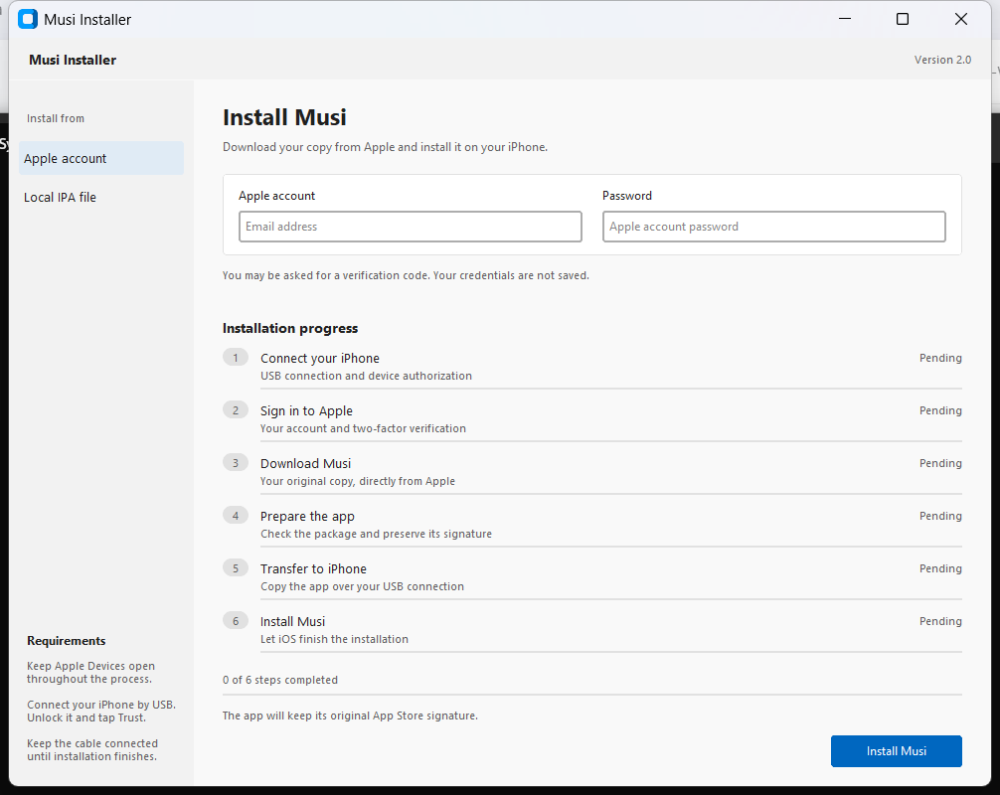

# Musi Installer

A Windows utility that downloads your own copy of Musi from Apple and installs it on your iPhone with its original App Store signature.

## Features

- Sign in with your Apple account and complete two-factor verification.
- Download directly using Musi's app ID, without searching the public catalog or the purchase listing.
- Follow six installation steps with individual progress indicators.
- See measured download and USB transfer percentages, bytes, speed and approximate time remaining.
- See the progress reported by iOS during installation.
- Install an original Musi IPA you already downloaded.
- Keep Apple credentials, session tokens and cookies in memory instead of storing them on disk.

## Requirements

- Windows x64.
- Python 3.10 or newer, with Tkinter and Python available in PATH.
- Apple Devices with working Apple USB drivers.
- An iPhone, USB cable and Apple account that previously obtained Musi.

**Keep Apple Devices open throughout the entire process, from connecting your iPhone until installation finishes.** Unlock your iPhone, tap Trust if prompted, and make sure it appears in Apple Devices before starting.

## Getting started: download and launch

### 1. Install the prerequisites

- Install **Python 3.10 or newer for Windows x64** from [python.org](https://www.python.org/downloads/windows/). In the installer, enable **Add python.exe to PATH** and keep the Tcl/Tk component selected. If Python is already installed, open Command Prompt and run `python --version` to check it.
- Install [Apple Devices from the Microsoft Store](https://apps.microsoft.com/detail/9np83lwlpz9k).

### 2. Download and extract the program

1. Open the [latest release](https://github.com/loyalmemories/musi-installer/releases/latest).
2. Under **Assets**, download **Musi-Installer-Windows-v2.0.zip**. Choose this file rather than GitHub's automatically generated source archives.
3. Right-click the ZIP and select **Extract All**. Open the extracted folder. You should see `START.cmd`, `app.py`, `requirements.txt` and the `bin` folder together.
4. Run the program from that extracted folder. Do not launch it from inside the ZIP or move `START.cmd` away from the other files.

### 3. Prepare your iPhone and start the program

1. Open **Apple Devices** and connect one iPhone by USB.
2. Unlock the iPhone, tap **Trust** if prompted, and confirm the phone appears in Apple Devices.
3. **Keep Apple Devices open for the entire download and installation.** Leave the USB cable connected until installation finishes.
4. Double-click **START.cmd**. On the first launch, a terminal prepares a local Python environment and downloads the required components. This can take several minutes; wait until the application window appears. An internet connection is required.
5. On later launches, double-click the same **START.cmd** again. You do not need to install the components manually.

### 4. Install Musi

1. Select **Apple account** in the application.
2. Enter the email and password of the Apple account that previously obtained Musi, then click **Install Musi**.
3. Enter the six-digit verification code if Apple requests one.
4. Follow the progress indicators and wait for the installation-complete message. Keep the phone connected and Apple Devices open during every step.
5. You can then unplug the cable and open Musi on your iPhone.

To restore your lifetime purchase or other in-app purchases, sign in with the original purchase account under **Settings > your name > Media & Purchases** on your iPhone, then use Musi's restore-purchases action. The account used for iCloud can differ from the account used for purchases.

For an existing personal IPA, select **Local IPA file** and choose the file instead. If Musi is already installed, this operation may update or replace that installation; it does not uninstall the app first.

Your downloaded IPA is saved to `Downloads\Musi` with a unique filename. No Musi IPA is included in this repository or release.

### Launch troubleshooting

- **Python is not recognized or setup fails:** install Python with the PATH option enabled, then run `START.cmd` again. If setup stops, the terminal remains open with the error message.
- **The download component is missing:** extract the full release ZIP again and check that `bin\musi-bridge.exe` is present.
- **The iPhone is not detected:** confirm it appears in Apple Devices, unlock it and accept the Trust prompt. Keep Apple Devices open and reconnect the USB cable if needed.
- **Apple rejects the download:** check the account that originally obtained Musi. Apple must still authorize the download for that account; having the app installed on another device does not guarantee a new download is available.
- **A purchase cannot be restored:** check the **Media & Purchases** account on the iPhone and use the account that made the original in-app purchase.

## Progress information

Download and transfer indicators use measured bytes. Their remaining-time estimates are approximate and change with connection speed. Sign-in, two-factor verification, device connection and package preparation do not have a reliable percentage or time estimate, so they use activity indicators and clear status messages. iOS controls the installation progress; a percentage is shown when iOS reports one. The overall indicator counts completed steps, not predicted elapsed time.

Technical logs are not shown in the main interface. If an operation fails, it displays an explanation and an optional Error details dialog.

## How it works

The Go bridge is built from the official majd/ipatool project at the exact commit recorded in source/UPSTREAM.txt. It uses upstream's current Apple configuration and SAP request signing. It downloads Musi directly using app ID 591560124, then preserves the account-specific original package information and signature files. It never requests a new app purchase.

The Python installer validates the Musi bundle ID (com.feelthemusi.musi), transfers the package over Apple File Conduit, and asks the iPhone's installation service to install it. Temporary staging files and connections are cleaned up after the operation.

An Apple account's previous acquisition does not guarantee that Apple still makes Musi available for download. Apple authorizes or rejects the request. Preserving the original signature avoids the periodic re-signing used by common sideloading workflows; it does not guarantee permanent availability or compatibility with future iOS versions. Package identification is not a cryptographic signature verification.

## Credentials

Credentials pass from the local Python interface to the local bridge over stdin, not through command-line arguments, environment variables or credential files. The bridge uses an in-memory key store and cookie jar. The password field is cleared when the operation starts. The program does not read or overwrite another ipatool session.

The SAP runtime may cache technical components under ipatool's cache directory. Those cached components are separate from this program's in-memory account session.

Do not share your IPA, password, verification code or session data in GitHub issues.

## Development

    python -m venv .venv
    .venv\Scripts\python.exe -m pip install -r requirements.txt
    .venv\Scripts\python.exe app.py

Run the Python tests:

    .venv\Scripts\python.exe -m unittest test_download test_installer -v

To rebuild the bridge, install Go 1.25 or newer, clone https://github.com/majd/ipatool, check out the commit in source/UPSTREAM.txt and copy source/musi-bridge to tools/musi-bridge in that checkout. From the ipatool checkout:

    go test ./tools/musi-bridge
    go build -trimpath -o musi-bridge.exe ./tools/musi-bridge

Place the resulting executable in bin.

Diagnostics without an Apple account:

    bin\musi-bridge.exe --diagnostics

Package validation without an iPhone:

    .venv\Scripts\python.exe installer.py "C:\path\Musi.ipa" --verify

See TESTING.md for the checks performed and their limits.

## Credits

- [ipatool](https://github.com/majd/ipatool), MIT licensed; its license is included as LICENSE-ipatool.txt.
- [pymobiledevice3](https://github.com/doronz88/pymobiledevice3).
- [CustomTkinter](https://github.com/TomSchimansky/CustomTkinter).

The interface takes layout references from Apple Devices, GitHub Desktop and Microsoft's Fluent guidance. See DESIGN.md. It uses no copied product logos or screenshots from those projects. The screenshot above is a local interface preview.

This project is not affiliated with Apple or Musi.
